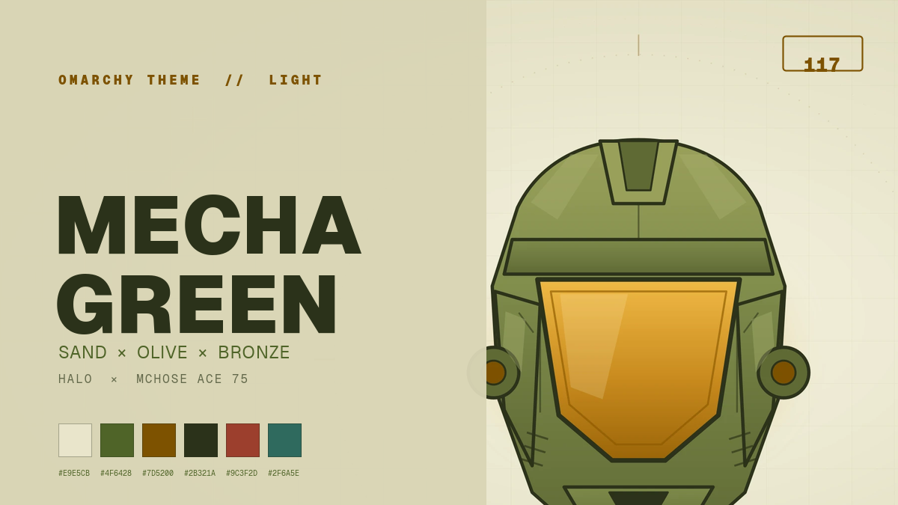
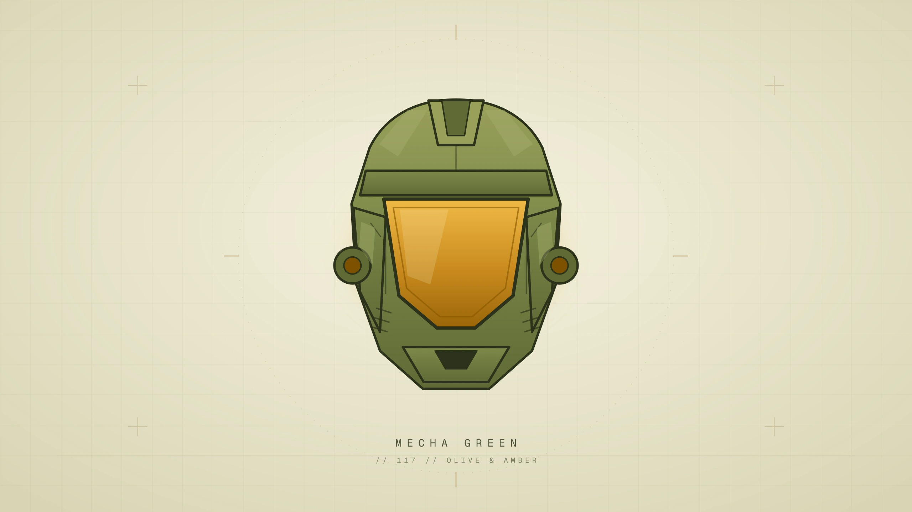
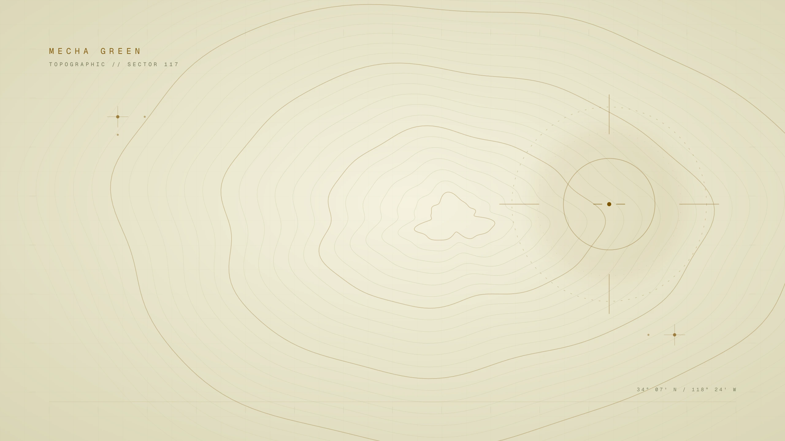
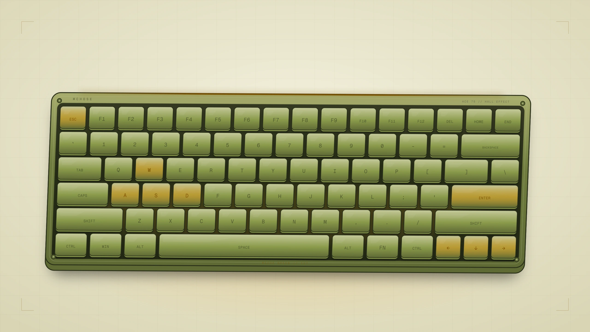
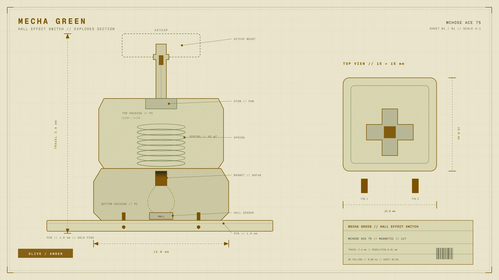
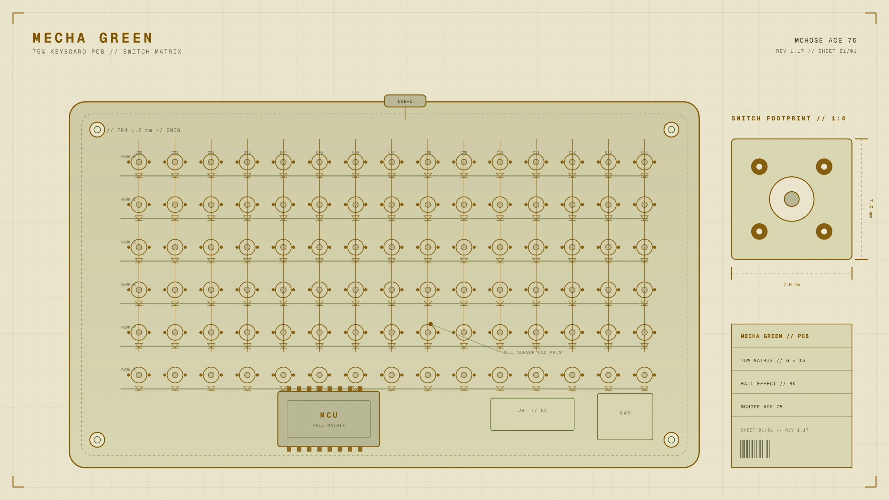
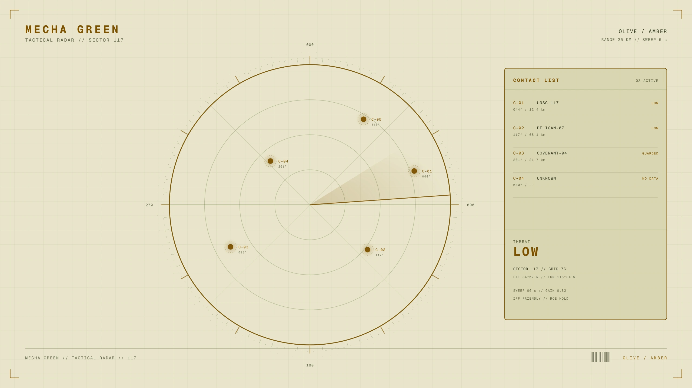
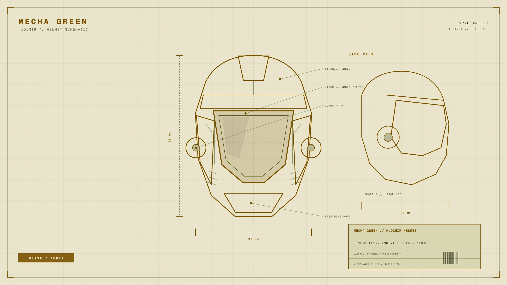
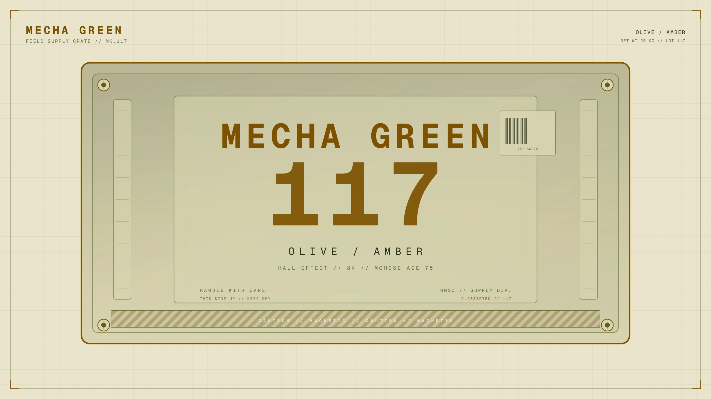

# Mecha Green Light



Sand, olive ink and bronze for Omarchy. The daylight half of the Mecha Green
pair, inspired by Halo's Master Chief and the MCHOSE Ace 75 Mecha Green
keyboard.

## Install

From this repository:

```sh
omarchy theme install https://github.com/sazardev/omarchy-mecha-green-light-theme
```

Once the registry listing is live, the short form is:

```sh
omarchy theme install mecha-green-light
```

The marketplace install keeps the palette, shell surfaces, btop, Chromium,
icons, keyboard RGB, unlock art and wallpapers. Omarchy regenerates the
terminal and Hyprland configs from `colors.toml`, so a theme installed from a
repository stays colours-only.

## Palette

| Role | Hex |
|---|---|
| Sand background | `#E9E5CB` |
| Raised surface | `#F1EEDA` |
| Olive | `#4F6428` |
| Bronze / accent | `#7D5200` |
| Dark olive ink | `#2B321A` |
| Rust | `#9C3F2D` |
| Deep patina | `#2F6A5E` |

The theme sets `mode = "light"`, so Omarchy pairs it with light mode across
apps. It styles the bar, menus, notifications, launcher, OSD, lock screen,
btop, Chromium, Neovim, Helix and the terminal.

## Wallpapers

Eight original 2560×1440 pieces, licensed MIT together with the theme:

| | |
|---|---|
| <br>**Mecha helmet** — sand Spartan helmet and bronze visor | <br>**Topographic HUD** — sand contours and a bronze reticle |
| <br>**MCHOSE Ace 75** — product-style keyboard render | <br>**Hall Effect switch** — cross-section and top view |
| <br>**PCB blueprint** — 75% keyboard matrix | <br>**Tactical radar** — contacts and threat readout |
| <br>**Helmet schematic** — MJOLNIR dimensions | <br>**Supply crate** — stencil and hazard strip |

Switch them with `omarchy theme bg next`, or pick one from the theme folder.

## Included

- `colors.toml` — the full light palette and `mode = "light"`.
- `shell.toml` — sand appbar, bronze indicators, gradient borders, light
  menus, launcher and lock screen.
- `btop.theme`, `chromium.theme`, `icons.theme` (`Yaru-olive`) and
  `keyboard.rgb`.
- `unlock.png` and `preview-unlock.png` — bronze Omarchy mark on sand.
- `preview.png` — 16:9 theme preview.
- `backgrounds/` — the eight originals above.

## Full project

The companion repository
[`sazardev/omarchy-mecha-green`](https://github.com/sazardev/omarchy-mecha-green)
adds:

- **Mecha Green**, the olive/amber dark twin.
- **Mecha HUD** and **Mecha NET** bar widgets with latency, CPU, RAM and
  battery telemetry.
- `mecha-status`, `mecha-themetize` and the optional Halo/military wallpaper
  fetcher with curated Spartans, UNSC, Covenant and Forerunner sets.
- **SDDM login** and **Plymouth boot** themes plus lock-screen previews.
- The two-theme `install.sh` for the complete setup.

## License

Theme configuration and original artwork are MIT. See [LICENSE](LICENSE).

Halo, Master Chief, MCHOSE and Omarchy are trademarks of their respective
owners. This is a personal fan theme, not affiliated with or endorsed by
Microsoft, 343 Industries, MCHOSE or Omarchy.
