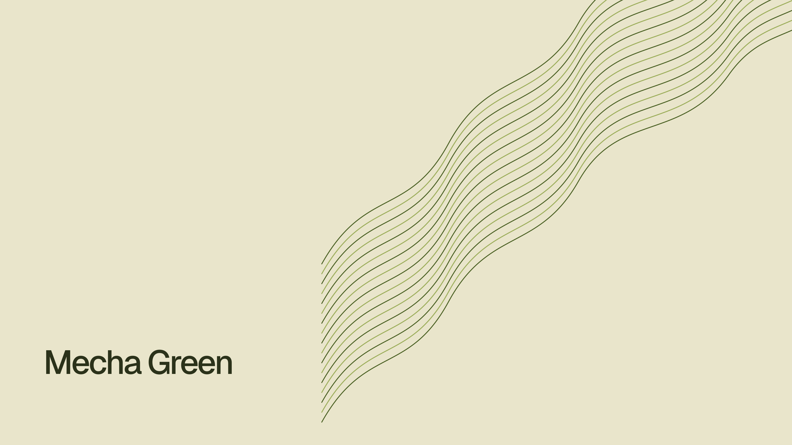
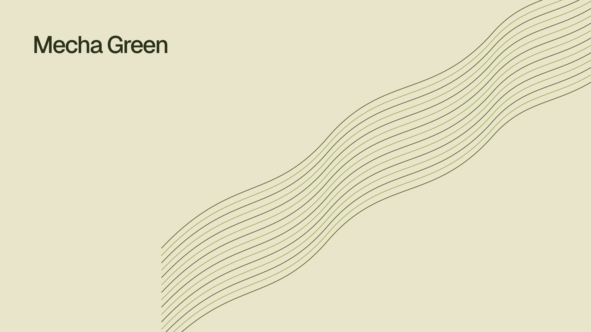
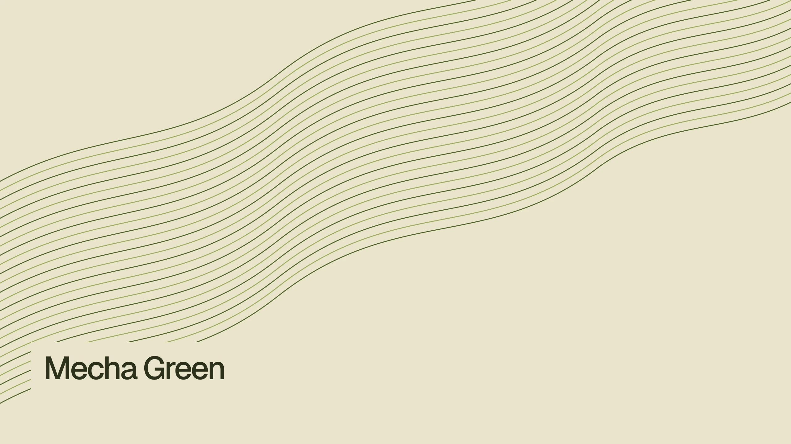

# Mecha Green Light


Sand, olive ink and bronze for Omarchy. The daylight half of the Mecha Green
pair, inspired by Halo's Master Chief and the MCHOSE Ace 75 Mecha Green
keyboard.

## Install

From this repository:

```sh
omarchy theme install https://github.com/sazardev/omarchy-mecha-green-light-theme
```

Once the registry listing is live, the short form is:

```sh
omarchy theme install mecha-green-light
```

The marketplace install keeps the palette, shell surfaces, btop, Chromium,
icons, keyboard RGB, unlock art and wallpapers. Omarchy regenerates the
terminal and Hyprland configs from `colors.toml`, so a theme installed from a
repository stays colours-only.

## Palette

| Role | Hex |
|---|---|
| Sand background | `#E9E5CB` |
| Raised surface | `#F1EEDA` |
| Olive | `#4F6428` |
| Bronze / accent | `#7D5200` |
| Dark olive ink | `#2B321A` |
| Rust | `#9C3F2D` |
| Deep patina | `#2F6A5E` |

The theme sets `mode = "light"`, so Omarchy pairs it with light mode across
apps. It styles the bar, menus, notifications, launcher, OSD, lock screen,
btop, Chromium, Neovim, Helix and the terminal.

## Wallpapers

Seven original flat stills and six clean live loops, licensed MIT together with
the theme:

| | |
|---|---|
| <br>**Default Wave** — the default brand wallpaper |
| <br>**Drift** — wide diagonal contours |
| <br>**Fold** — vertical contour folds |
| <br>**Field** — full-screen horizontal contours |
| <br>**Terrain** — full-screen nested contours |
| <br>**Panorama** — full-bleed diagonal wave |
| <br>**Undulate** — full-screen low wave |

`0-topographic-light.webp` sorts first and remains the default. The `100-`
series avoids collisions with optional Halo wallpapers. Each of the six new
designs also has an 8-second H.264 live loop with animated lines and fixed
typography.

## Included

- `colors.toml` — the full light palette and `mode = "light"`.
- `shell.toml` — sand appbar, bronze indicators, gradient borders, light
  menus, launcher and lock screen.
- `btop.theme`, `chromium.theme`, `icons.theme` (`Yaru-olive`) and
  `keyboard.rgb`.
- `unlock.png` and `preview-unlock.png` — bronze Omarchy mark on sand.
- `preview.png` — 16:9 theme preview.
- `backgrounds/` — seven flat stills and six live loops, with
  `0-topographic-light.webp` as the default.

## Full project

The companion repository
[`sazardev/omarchy-mecha-green`](https://github.com/sazardev/omarchy-mecha-green)
adds:

- **Mecha Green**, the olive/amber dark twin.
- **Mecha HUD** and **Mecha NET** bar widgets with latency, CPU, RAM and
  battery telemetry.
- `mecha-status`, `mecha-themetize`, `mecha-livewall` and the optional
  Halo/military wallpaper fetcher with curated Spartans, UNSC, Covenant and
  Forerunner sets, plus the filtered Halo live loops.
- **SDDM login** and **Plymouth boot** themes plus lock-screen previews.
- The two-theme `install.sh` for the complete setup.

## Login and boot screens (optional)

Install the matching flat SDDM login and Plymouth splash without cloning the
full project:

```sh
sudo bash -c "$(curl -fsSL https://raw.githubusercontent.com/sazardev/omarchy-mecha-green/main/system/install-login.sh)"
```

The installer backs up the current configuration and rebuilds the initramfs.
The login appears after logout/reboot; the Plymouth splash appears on the next
boot. Requires `git`, SDDM and Plymouth.

## License

Theme configuration and original artwork are MIT. See [LICENSE](LICENSE).

Halo, Master Chief, MCHOSE and Omarchy are trademarks of their respective
owners. This is a personal fan theme, not affiliated with or endorsed by
Microsoft, 343 Industries, MCHOSE or Omarchy.
